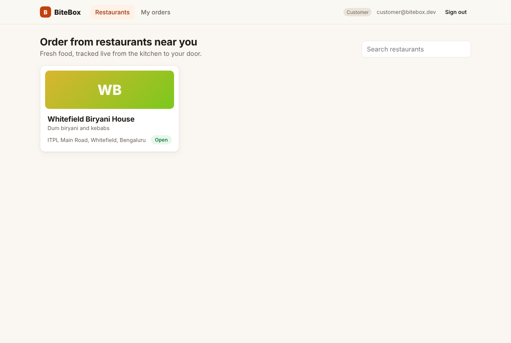
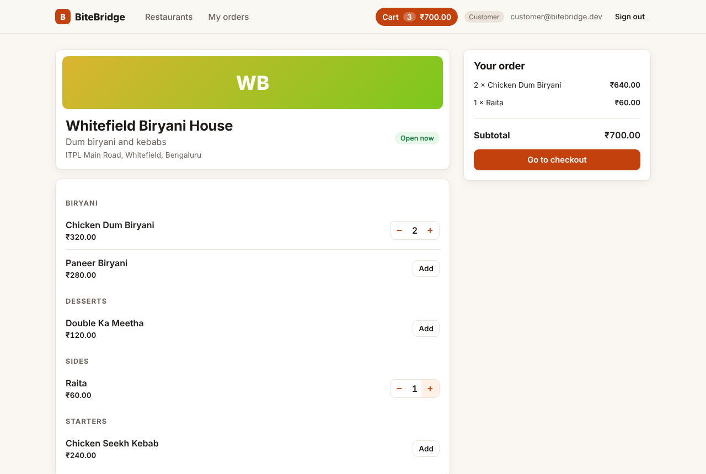
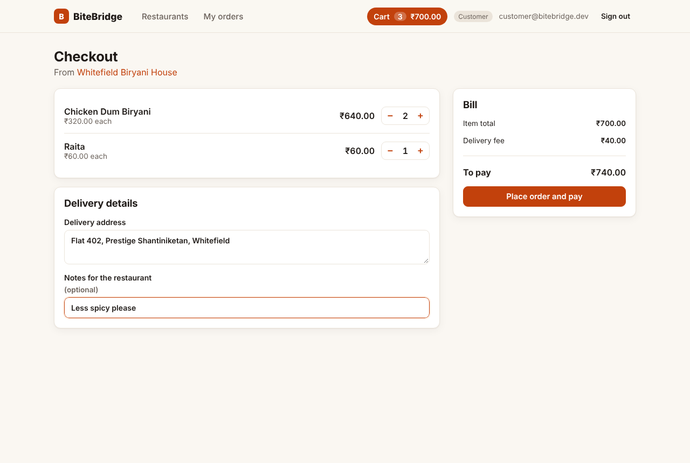
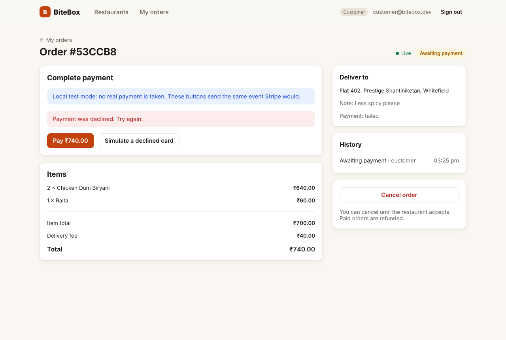
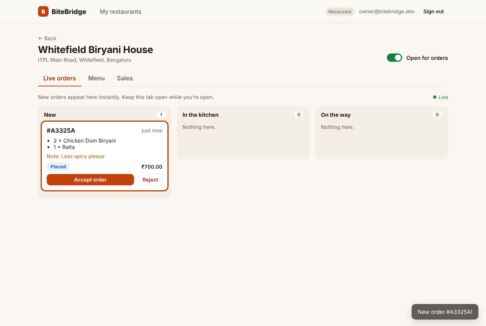
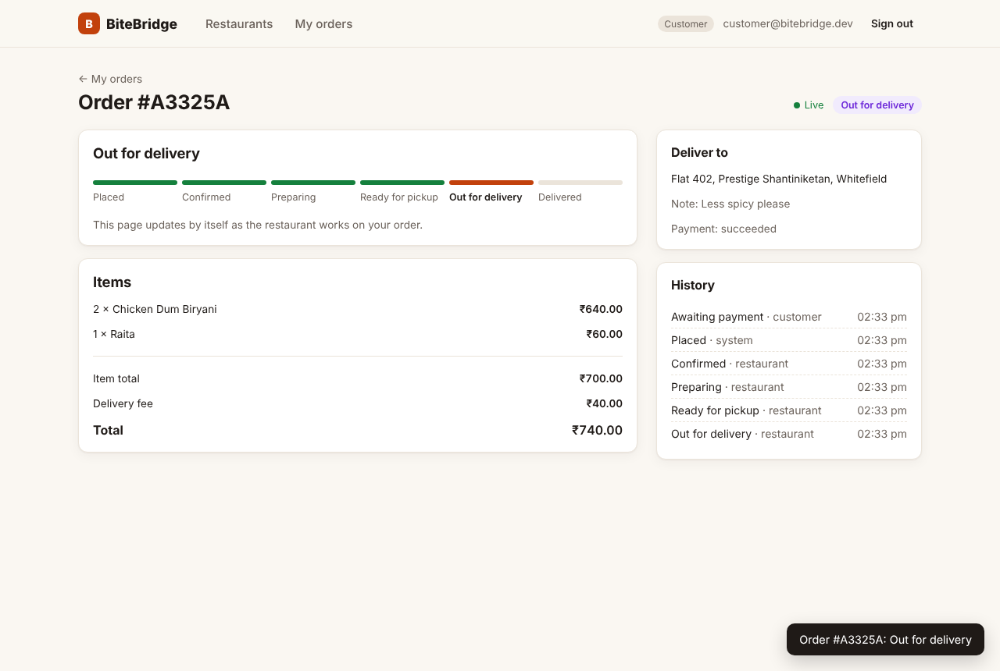
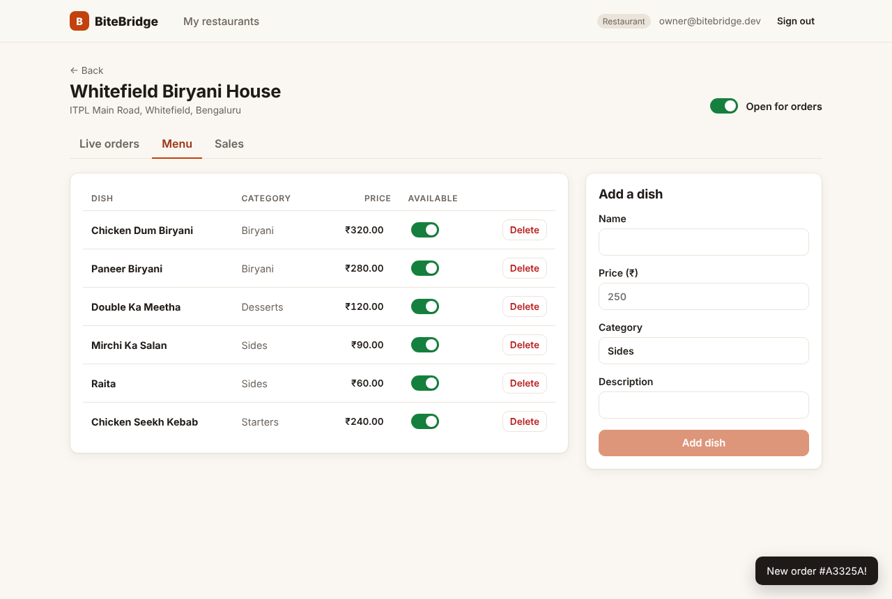
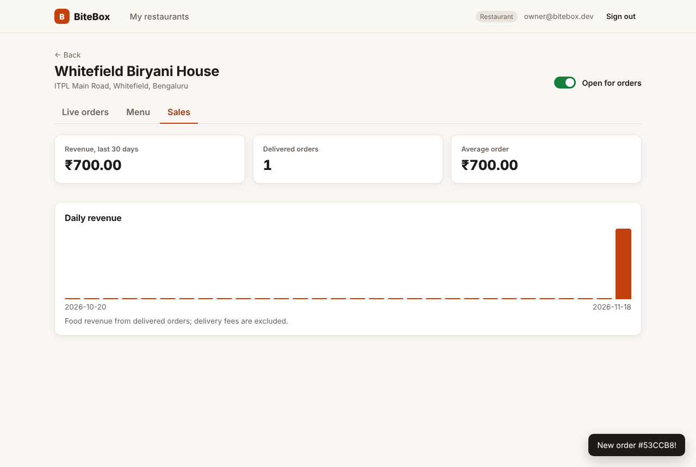
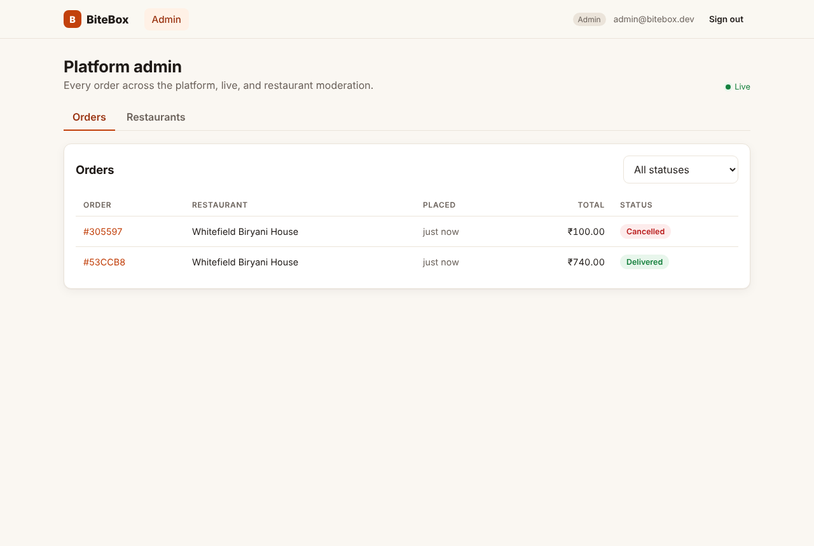

# BiteBox Web

The web front end for **BiteBox**, a food ordering and delivery platform. One app, three experiences:

- **Customers** browse restaurants, fill a cart, pay and watch their order move from kitchen to door, live.
- **Restaurant owners** get a live order board, a menu editor and sales reports.
- **Admins** see every order on the platform and can suspend restaurants.

The backend is in [bitebox-api](https://github.com/rkparupudi/bitebox-api). The Android and iOS apps are in [bitebox-mobile](https://github.com/rkparupudi/bitebox-mobile). All three use the same API, so an order placed on a phone appears live on the restaurant's web dashboard, and the other way round. `src/api/types.ts` and `src/lib/format.ts` are shared verbatim with the mobile app.


| | |
|---|---|
| **Framework** | React 18 + TypeScript (strict) |
| **Build tool** | Vite 5 |
| **Routing** | React Router 6 |
| **Server state** | TanStack Query 5 (caching, refetching, mutations) |
| **Real time** | Socket.IO client (WebSocket transport) |
| **Payments** | Stripe Elements (`@stripe/react-stripe-js`), loaded only when needed |
| **Styling** | Plain CSS with design tokens (CSS variables); no UI framework |
| **Hosting** | Static files on S3 + CloudFront (see the API repo's `DEPLOYMENT.md`) |

---

## Contents

1. [Screenshots](#screenshots)
2. [Quick start](#quick-start)
3. [Trying the main flows](#trying-the-main-flows)
4. [Configuration](#configuration)
5. [npm scripts](#npm-scripts)
6. [Project structure](#project-structure)
7. [Routes and screens](#routes-and-screens)
8. [How it works](#how-it-works)
9. [Payments in the UI](#payments-in-the-ui)
10. [Styling](#styling)
11. [Building and deploying](#building-and-deploying)
12. [Manual test checklist](#manual-test-checklist)
13. [Troubleshooting](#troubleshooting)
14. [Roadmap](#roadmap)

---

## Screenshots

| Customer: restaurants | Customer: menu and cart |
|---|---|
|  |  |

| Customer: checkout | Customer: payment (local test mode) |
|---|---|
|  |  |

| Restaurant: a new order arrives live | Customer: live tracking |
|---|---|
|  |  |

| Restaurant: menu editor | Restaurant: sales |
|---|---|
|  |  |

| Admin: all orders |
|---|
|  |

---

## Quick start

### Prerequisites

- **Node.js 22**
- The **BiteBox API running on http://localhost:3000**, seeded with demo data. Follow the API repo's Quick start; it takes about five minutes with Docker Desktop.

### Run

```bash
npm install
npm run dev
```

Open **http://localhost:5173**.

In development, Vite **proxies** `/api/*` and the WebSocket path `/socket.io` to `localhost:3000`. The browser only ever talks to `localhost:5173`, so there's no CORS setup and no `.env` file needed.

### Demo accounts

The sign-in page shows one-click buttons for the seeded accounts. They appear only in development builds.

| Role | Email | Password |
|---|---|---|
| Customer | `customer@bitebox.dev` | `password123` |
| Restaurant owner | `owner@bitebox.dev` | `password123` |
| Admin | `admin@bitebox.dev` | `password123` |

---

## Trying the main flows

**See real time in action.** Use two windows side by side: one normal, one incognito (they don't share sign-ins).

1. **Window 1:** sign in as the **restaurant owner**, open *Whitefield Biryani House* → **Live orders**. The **Live** dot goes green.
2. **Window 2:** sign in as the **customer**, open the restaurant, add a couple of dishes, then **Go to checkout**.
3. Enter an address, then **Place order and pay**.
4. On the payment screen, click **Simulate a declined card** (the payment shows as failed), then **Pay**.
5. **Window 1:** the order appears on the board instantly, with a toast and a highlight.
6. Click **Accept order → Start preparing → Mark ready → Out for delivery → Mark delivered**. **Window 2** updates at every step without reloading.
7. Back in window 1, open **Sales** to see the revenue, and **Menu** to add a dish. It shows up on the customer's menu right away.

**Other things to try:**
- Cancel an order as the customer before the restaurant accepts. It's refunded.
- **Reject** an order as the restaurant. The customer is refunded and sees the reason.
- Add a dish from a second restaurant to a cart. You're asked whether to start a new cart.
- Sign in as **admin**: watch all orders live, filter by status, suspend a restaurant (it disappears for customers).
- Browse while signed out: menus are visible, and adding to the cart asks you to sign in.

---

## Configuration

| Variable | When | Example | Purpose |
|---|---|---|---|
| `VITE_API_URL` | production builds | `https://api.yourdomain.com` | Public URL of the API. Leave **empty** in development to use the Vite proxy |
| `VITE_DEV_API_TARGET` | optional, dev only | `http://localhost:3000` | Where the dev proxy forwards to (if the API runs elsewhere) |

`VITE_` variables are **baked into the JavaScript at build time**, so they must never contain secrets. Everything else the app needs (payment mode, Stripe *publishable* key, currency, delivery fee) comes from the API's `GET /config` at runtime. That means one build works in any environment.

---

## npm scripts

| Script | What it does |
|---|---|
| `npm run dev` | Dev server with hot reload on http://localhost:5173 |
| `npm run build` | Type-check (`tsc -b`) and build static files into `dist/` |
| `npm run preview` | Serve the production build locally to check it |
| `npm run typecheck` | Type-check only |

---

## Project structure

```
src/
├── main.tsx                    # providers: TanStack Query, Router, Auth, Toasts
├── App.tsx                     # routes + role-based route guards
├── styles.css                  # design tokens and all styles
├── api/
│   ├── client.ts               # one typed function per API endpoint; JWT handling; errors
│   └── types.ts                # TypeScript shapes of every API response
├── auth/
│   └── AuthContext.tsx         # current user, login/register/logout, session restore
├── lib/
│   ├── realtime.ts             # shared Socket.IO connection + useOrderUpdates hook
│   └── format.ts               # money formatting (₹), status labels, workflow steps
├── components/
│   ├── Layout.tsx              # top bar, role-aware navigation, cart pill
│   └── ui.tsx                  # StatusBadge, LiveDot, OrderProgress, Qty, TileArt, toasts
└── pages/
    ├── AuthPages.tsx           # sign in (with dev demo buttons), register
    ├── customer/
    │   ├── RestaurantsPage.tsx # list + debounced search
    │   ├── MenuPage.tsx        # menu by category, add to cart, order summary
    │   ├── CartPage.tsx        # quantities, address, bill, place order
    │   ├── PaymentPanel.tsx    # Stripe Elements or local simulator
    │   ├── OrderPage.tsx       # live tracking, history, cancel
    │   └── OrdersPage.tsx      # order history
    ├── owner/
    │   ├── DashboardPage.tsx   # my restaurants, create one
    │   └── RestaurantAdminPage.tsx  # live order board, menu editor, sales
    └── admin/
        └── AdminPage.tsx       # all orders (live), restaurant moderation
docs/screenshots/               # images used in this README
.github/workflows/
├── ci.yml                      # type-check and build on every push
└── deploy.yml                  # build → S3 → CloudFront invalidation (OIDC)
```

---

## Routes and screens

| Path | Who | Screen |
|---|---|---|
| `/` | everyone (owners and admins are sent to their home) | Restaurant list and search |
| `/r/:id` | everyone | Menu; customers can add to the cart |
| `/login`, `/register` | signed out | Sign in, sign up (customer or restaurant owner) |
| `/cart` | customer | Checkout |
| `/orders` | customer | Order history (live) |
| `/orders/:id` | the customer, the restaurant, admin | Order detail: payment, live progress, history, cancel |
| `/dashboard` | restaurant owner | My restaurants; create one |
| `/dashboard/:id?tab=orders\|menu\|sales` | owner of it, admin | Live order board · Menu editor · Sales |
| `/admin` | admin | All orders · Restaurants (suspend/reinstate) |

After sign-in, each role lands on its own home: customers on `/`, owners on `/dashboard`, admins on `/admin`.

**Route guards are only there for a smooth experience** (a redirect instead of an error page). Real security is on the API, which checks the token, role and ownership on every request.

---

## How it works

### Talking to the API: `src/api/client.ts`

- One typed function per endpoint (`api.checkout()`, `api.setOrderStatus()` …), so a backend change surfaces as a TypeScript error.
- Attaches `Authorization: Bearer <token>` automatically. The token lives in `localStorage`.
- Turns API errors into an `ApiError` with the HTTP status and a readable message. NestJS's validation arrays are joined into one sentence.
- On a **401** with a stored token, it fires an event that signs the user out (for example, when the token expired).

### Server state: TanStack Query

Screens never hold API data in `useState`. They use queries with stable keys:

| Query key | Data |
|---|---|
| `['restaurants', q]` | restaurant list / search |
| `['menu', id]` | public menu |
| `['cart']` | the customer's cart |
| `['orders']` / `['order', id]` | customer orders / one order |
| `['restaurant-orders', id]` | the owner's order board |
| `['owner-menu', id]`, `['sales', id]`, `['my-restaurants']` | owner screens |
| `['admin-orders', status]`, `['admin-restaurants']` | admin screens |
| `['config']` | public API settings (fetched once) |

Mutations either write the server's response straight into the cache (`setQueryData`, as for the cart) or invalidate the affected keys. Errors in the 4xx range aren't retried, because a 403 won't fix itself. Signing in or out **clears the whole cache**, so one user's data never shows up for the next.

### Real time: `src/lib/realtime.ts`

- **One shared Socket.IO connection** per signed-in session, authenticated with the same JWT.
- `transports: ['websocket']` skips the long-polling fallback. With several API instances behind a load balancer, polling would need sticky sessions; a pure WebSocket doesn't.
- `useOrderUpdates(callback?)` subscribes a screen to `order.updated` events. Each event **invalidates the matching query keys**, so every screen that shows that order refetches and re-renders. No polling anywhere.
- It returns whether the socket is connected, shown as the **Live** dot.
- The server decides which events a user receives (their own orders; their restaurants' paid orders; everything for admins). The client can't subscribe to anything else.

### Auth: `src/auth/AuthContext.tsx`

On load, a stored token is exchanged for the user via `GET /auth/me`. If that fails, the token is dropped. `login` and `register` store the token and reset the query cache. `logout` clears the token, the cache and the socket.

### Money

The API sends every amount as an **integer in minor units** (`32000` = ₹320.00). `money()` in `lib/format.ts` formats it with `Intl.NumberFormat('en-IN')`. The owner's menu form converts typed rupees back with `toMinor()`. The UI never sends a price to the API; totals are always computed on the server.

---

## Payments in the UI

The API's `GET /config` says which mode it's in, and `PaymentPanel.tsx` renders accordingly.

| API mode | What the customer sees |
|---|---|
| `PAYMENTS_PROVIDER=fake` (local default) | A "Local test mode" banner with **Pay** and **Simulate a declined card** buttons. They call the API's simulator, which runs the same webhook logic as real Stripe |
| `PAYMENTS_PROVIDER=stripe` | Stripe's **Payment Element**. Card details go straight from the browser to Stripe and never reach our servers. Test card: `4242 4242 4242 4242` |

In both modes, **the screen doesn't decide that payment succeeded**. The order only becomes "Placed" when the API receives the payment event, and the page updates through the socket.

Stripe.js is imported from `@stripe/stripe-js/pure`, so it's downloaded **only when the Stripe form is actually shown**, not on every page.

---

## Styling

- One stylesheet, `src/styles.css`, built on CSS variables (`--brand`, `--ink`, `--surface`, `--ok`, `--bad` …). Changing the brand colour is a one-line edit.
- Warm off-white background, orange brand colour, status colours used consistently: blue placed, orange in progress, purple on the way, green delivered, red cancelled.
- Responsive: the two-column layouts stack below 860 px wide.
- Restaurant "photos" are generated gradient tiles with initials (`TileArt`), so the app needs no image hosting yet.
- No UI framework, to keep the bundle small (about 96 KB gzipped JavaScript) and every style easy to find.

---

## Building and deploying

```bash
VITE_API_URL=https://api.yourdomain.com npm run build
# Windows PowerShell:
#   $env:VITE_API_URL="https://api.yourdomain.com"; npm run build
```

`dist/` is a plain static site: `index.html` plus hashed files in `assets/`. Any static host works. Two requirements:

1. **Single-page app fallback:** unknown paths must serve `index.html`, so deep links like `/orders/abc` work. On CloudFront: custom error responses 403/404 → `/index.html` with status 200.
2. **Caching:** `assets/*` filenames change with every build, so they can be cached for a year. `index.html` must not be cached.

The included GitHub Actions workflow (`.github/workflows/deploy.yml`) does both on every push to `main` that passes CI:
1. Builds with `VITE_API_URL`.
2. Syncs assets to S3 with `Cache-Control: max-age=31536000, immutable` and `index.html` with `no-cache`.
3. Invalidates `index.html` in CloudFront.

It signs in to AWS through **OIDC**, so no AWS keys are stored in GitHub. It skips itself until the repository variables are set. Full AWS setup, including costs, is in the API repo's [DEPLOYMENT.md](https://github.com/rkparupudi/bitebox-api/blob/main/DEPLOYMENT.md).

For the cheaper single-server option, copy `dist/` to the server, where Caddy serves it (also in DEPLOYMENT.md).

---

## Manual test checklist

Run through this before a release. Use two browser windows for the real-time items.

- [ ] Sign up as a customer and as an owner; sign in and out; refreshing the page keeps you signed in
- [ ] Owner: create a restaurant, add dishes, change a price, mark one unavailable, open the restaurant
- [ ] Customer: the new restaurant appears; unavailable dish hidden; price change visible
- [ ] Customer: cart quantities, removing items, the switch-restaurant prompt
- [ ] Customer: checkout disabled until an address is entered; correct bill including delivery fee
- [ ] Payment declined → can retry; payment succeeds → status becomes Placed
- [ ] Owner board receives the order **without refreshing**; toast and highlight shown
- [ ] Every owner step updates the customer's page **without refreshing**
- [ ] Customer can cancel before acceptance (refunded); can't after
- [ ] Owner can reject; customer sees the cancellation and refund
- [ ] Sales tab shows delivered revenue
- [ ] Admin: orders appear live; status filter; suspend → restaurant disappears for customers; reinstate
- [ ] Signed out: can browse menus; "Sign in to add" shown
- [ ] Narrow window (mobile width): layouts stack and remain usable

---

## Troubleshooting

| Symptom | Fix |
|---|---|
| Blank list, or "Failed to fetch" / 502 from `/api/...` | The API isn't running on :3000. Start it (`npm run start:dev` in bitebox-api) |
| "Connecting…" never turns into "Live" | The API is down, or your token expired. Sign out and back in |
| No demo login buttons on the sign-in page | They only appear in `npm run dev`, not in production builds |
| Demo login fails with "Invalid email or password" | Seed the API: `npm run seed` in bitebox-api |
| "Stripe is not configured" on the payment screen | The API is in Stripe mode without `STRIPE_PUBLISHABLE_KEY`. Set it, or use `PAYMENTS_PROVIDER=fake` locally |
| Deep link returns 404 after deploying | Configure the single-page app fallback (see [Building and deploying](#building-and-deploying)) |
| Production site calls the wrong API | `VITE_API_URL` is baked in at build time. Rebuild with the right value |
| "Too many requests" when signing in repeatedly | The API's login rate limit (10/min by default). Wait a minute or raise it in the API's `.env` |

---

## Roadmap

- Browser end-to-end tests in CI (Playwright) for the flows in the checklist
- Delivery address book and saved payment methods
- Restaurant photos via S3 uploads
- Order notifications with sound for the restaurant board
- Accessibility pass (focus management, ARIA live regions for order updates)

---

## License

[MIT](LICENSE)
